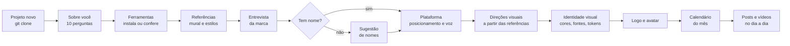

# Estúdio Criativo com IA

> Data: 2026-10-25 · Tipo: entrada · Status: vigente

**Resumo:** um modelo reutilizável de estúdio criativo para usar com o Claude Code (ou o Codex). Faz vídeo (Remotion, HyperFrames, EffectCraft), design de marca (identidade visual, logo, avatar, posts) e o texto e o planejamento das redes sociais. Cada estúdio começa de uma cópia limpa deste modelo e, dentro dela, cada marca tem a sua pasta com tudo o que é dela.

## Usar em um projeto novo

1. Copie o modelo para uma pasta nova (sem acento, fora do OneDrive):

   ```bash
   git clone https://github.com/Vini-Guedesz/estudio-criativo.git C:\projetos\nome-do-projeto
   ```

2. Abra o Claude Code dentro dessa pasta e diga **"oi"**. Ele percebe que o projeto é novo e conduz, nesta ordem:
   1. **Você:** liga a memória e faz a entrevista sobre você (`setup/1-segundo-cerebro.md`).
   2. **Ferramentas:** instala tudo (`setup/2-instalar.md`). Num computador que já tem tudo, só confere.
   3. **Referências:** cria a pasta de referências, local ou no Google Drive, e mostra o mural de links e as fichas de estilo (`setup/3-referencias.md`).
   4. **Marca:** cria a pasta da marca, pede de 5 a 10 links de referência, faz a entrevista, propõe direções visuais a partir das referências e cria as primeiras peças (`setup/4-marca.md`).

3. Depois disso, peça: "cria o logo", "faz um carrossel sobre X", "vamos fazer um Reel sobre Y".

Os dados de cada projeto (perfil, briefing, logo, posts, vídeos) ficam na pasta do projeto. O modelo continua limpo.

## Como funciona



Tudo que é decidido (cores, fontes, tom de voz, logo escolhido) fica registrado na pasta da marca, em `04-marcas/<marca>/`, e na memória. Por isso cada post e cada vídeo novo já sai com a cara da marca, sem precisar explicar de novo.

## O que pedir no dia a dia

Abra o Claude Code na pasta do projeto e peça em português, do seu jeito. Exemplos:

**Marca**
- "Sugere 3 direções de identidade visual para a marca"
- "Cria 5 conceitos de logo e me mostra"
- "Vetoriza esse desenho do logo" (arraste a imagem para a pasta `00-entrada/`)
- "Faz um avatar ilustrado da marca no estilo flat"
- "Monta o manual da marca com usos certos e errados do logo"

**Posts**
- "Cria um carrossel de 5 telas sobre [assunto]"
- "Faz 3 posts de lançamento com a identidade da marca"
- "Escreve a legenda desse post no tom da marca"
- "Remove o fundo dessa foto e coloca num post"

**Vídeo**
- "Vamos fazer um Reel de 30 segundos sobre [assunto]"
- "Cria uma abertura animada com o logo"
- "Coloca legenda nesse vídeo" / "Corta as pausas dessa gravação"
- "Analisa esse vídeo de referência quadro a quadro" (cole o link)

**Planejamento**
- "Monta o calendário de novembro da marca"
- "Transforma esse vídeo longo em cortes e um carrossel"
- "Faz o relatório do mês com esses prints do Insights"

**Referências**
- "Salvei uns links no mural, começa pelas referências"
- "Qual é o estilo desse vídeo?" (cole o link)
- "Quero um carrossel no estilo neobrutalista"

**Organização**
- "Organiza as referências que joguei na pasta"
- "O que decidimos sobre as cores da marca?"
- "Confere se está tudo instalado"

## O que vem dentro

- **Segundo cérebro organizado:** pastas para ideias, perfil, ferramentas, referências, marcas, biblioteca e método, com regras que a IA lê sozinha ao abrir a pasta (`AGENTS.md`).
- **Memória entre sessões** com o [ai-memory](https://github.com/akitaonrails/ai-memory): o que foi decidido ontem, a IA sabe hoje.
- **Entrevistas guiadas** sobre você (`01-sobre-mim/perfil.md`) e sobre a marca (`04-marcas/<marca>/identidade/briefing.md`).
- **Método de vídeo do zero** em 10 etapas (`06-metodo/`).
- **Skills do estúdio:** `estudio-video`, `video-referencias`, `motion-narrado`, `animacao-saas`, `ui-para-video`, `som-do-video`, `copy-redes` (gancho, legenda, carrossel, roteiro curto, bio, voz da marca), `redes-sociais` (calendário, plataformas, reaproveitamento, métricas e relatório) e `referencias-e-estilos` (mural de links, fichas de estilo e o pontapé inicial pelas referências).
- **16 fichas de estilo visual** (`03-referencias/estilos/`): pixel art, neobrutalismo, glassmorfismo, minimalismo suíço, clean tech, Y2K, synthwave, VHS, flat, 3D clay, colagem, risografia, Memphis, tipografia cinética, luxo escuro e doodle.
- **Scripts de som e vídeo:** mixagem a partir dos eventos da animação, nivelamento de efeitos sonoros, batidas da música, separação de voz, legendas, corte de pausas e análise quadro a quadro.
- **Uma pasta por marca** (`04-marcas/`) com identidade, referências e todas as peças (reels, posts, carrosséis, stories, vídeos), sempre com `rascunhos/` e `final/`. Ferramentas de design detalhadas abaixo.

## Marcas e peças (`04-marcas/`)

Tudo de uma marca mora numa pasta só, e toda peça segue o mesmo padrão (detalhes em `04-marcas/_LEIA.md`):

```
04-marcas/cafe-do-ze/
├── identidade/      briefing, plataforma (voz), cores e fontes, logo, avatar
├── referencias/     mural.md (links), análises e mídia só desta marca
├── modelos/         modelos de post e vídeo reutilizáveis
├── calendario.md    pilares, ritmo e plano de publicação
├── resultados.md    números de cada peça e relatório do mês
├── reels/2026-10-25-lancamento/
│   ├── copy.md      ganchos, texto da tela, legenda, hashtags, CTA
│   ├── rascunhos/   lancamento-reels-v1.mp4, v2...
│   └── final/       lancamento-reels.mp4, lancamento-reels-legenda.txt  (só o aprovado)
├── posts/  carrosseis/  stories/  videos/
```

| Comando (da raiz do estúdio) | Faz |
|---|---|
| `uv run scripts/peca.py marca "Café do Zé"` | cria a pasta da marca a partir do modelo |
| `uv run scripts/peca.py renomear "Café do Zé Ltda"` | troca o nome da marca e atualiza os caminhos |
| `uv run scripts/peca.py nova reels "Lançamento"` | cria a peça com as pastas certas (`reels`, `videos`, `stories`, `posts`, `carrosseis`) |
| `uv run scripts/peca.py rascunho <peça> mp4` | diz o nome do próximo rascunho (`--extra legenda` para legenda, capa, miniatura) |
| `uv run scripts/peca.py aprovar <rascunho>` | copia para `final/` com o nome limpo e anota na ficha da peça |
| `uv run scripts/peca.py lista` | mostra as marcas e as peças |

## Referências e estilos (`03-referencias/`)

- **Mural de links:** salve Reels, vídeos, imagens, perfis e sites em `03-referencias/mural.md` (ou no mural da marca), com o que chamou atenção. `uv run scripts/referencias.py mural --baixar` baixa os vídeos e imagens novos e `capturar <url>` tira a tela de um site.
- **Fichas de estilo:** `03-referencias/estilos/` descreve 16 linguagens visuais (como reconhecer, paleta, fontes gratuitas, movimento, som, quando usar e como fazer no estúdio).
- **Pontapé inicial:** peça "começa pelas referências" e a IA analisa o mural, dá nome aos estilos e propõe 2 ou 3 direções visuais com uma prova de cada.

## Ferramentas de design (`scripts/design/`)

Os comandos Node rodam da raiz com `npm run <comando> --prefix scripts/design -- ...` e trabalham na pasta da marca (com mais de uma marca, `--marca <nome>`).

| Ferramenta | Para quê |
|---|---|
| Satori + resvg | Posts e telas de carrossel em PNG com a fonte, as cores (escolhidas pelo contraste), o estilo e o logo da marca, salvos em `rascunhos/` da peça (`npm run post -- --peca <peça> "Título" "apoio" --layout capa\|conteudo\|cta`) |
| `logo.py` · `render.py` | Logo com o nome em curvas, versões de cidade, foto de perfil e folha de conceito · HTML em imagem nos tamanhos do estúdio |
| DiceBear | Avatares em SVG para rascunho, em `identidade/avatar/` (`npm run avatar`) |
| Style Dictionary | Exporta cores e fontes da marca para CSS/JSON, usados por posts e vídeos (`npm run tokens`) |
| SVGO | Otimiza os SVGs de `identidade/logo/` (`npm run svg`) |
| vtracer | Transforma um desenho/PNG em vetor SVG |
| rembg | Remove fundo de fotos |
| coloraide + colorthief | Extrai paletas de referências e confere contraste |
| Inkscape · PhotoCraft · Figma · Krita | Vetor e logo · edição de imagem e `.psd` · layout · ilustração |
| Skills da Anthropic | canvas-design, brand-guidelines, theme-factory, algorithmic-art |

## Instalação

A IA roda o instalador no roteiro 2, mas ele também pode ser rodado à mão:

- Windows: `powershell -ExecutionPolicy Bypass -File setup\instalar-windows.ps1`
- Mac: `bash setup/instalar-mac.sh`

Opções: `-AppsDesign` / `--apps-design` (Figma e Krita), `-Leve` / `--leve` (sem IA de áudio), `-SemEffectCraft` / `--sem-effectcraft`, `-SemIAs` / `--sem-ias`. Rodar de novo é seguro: só instala o que falta. O DaVinci Resolve (edição manual, grátis) é baixado à mão no site da Blackmagic.

Para conferir o que está instalado: `uv run setup/conferir.py`.

**Download:** de 2 a 6 GB, conforme o computador tenha ou não placa NVIDIA. Deixe 15 GB livres.

## As pastas

| Pasta | O que guarda |
|---|---|
| `00-entrada/` | Ideia crua, ditado, print solto |
| `01-sobre-mim/` | Seu perfil: quem é, o que cria, como fala |
| `02-ferramentas/` | Um doc por ferramenta |
| `03-referencias/` | Mural de links, fichas de estilo, referências organizadas, catálogo e análises |
| `04-marcas/` | Uma pasta por marca: identidade, referências e todas as peças (reels, posts, carrosséis, stories, vídeos) |
| `05-biblioteca/` | Efeitos sonoros, músicas, fontes e assets |
| `06-metodo/` | Passo a passo, números que valem e aprendizados |
| `scripts/` | Scripts de som, vídeo, design, referências e peças |
| `anotacoes/` | O registro de cada sessão |
| `setup/` | Instaladores e os quatro roteiros |

## Requisitos

Windows 10 ou 11, ou macOS 13 ou mais novo, com 8 GB de RAM (16 GB recomendados para render) e 15 GB livres em disco. A placa NVIDIA é opcional: acelera a separação de voz e a detecção de batidas. O After Effects é opcional e pago; o EffectCraft, o HyperFrames e o Remotion são gratuitos.

## Créditos

Este estúdio junta ferramentas de código aberto e gratuitas. Obrigado a quem as mantém:

- **Vídeo:** [Remotion](https://github.com/remotion-dev/remotion), [HyperFrames](https://github.com/heygen-com/hyperframes), [EffectCraft](https://github.com/storytold/effectcraft), [FFmpeg](https://ffmpeg.org), [faster-whisper](https://github.com/SYSTRAN/faster-whisper), [librosa](https://github.com/librosa/librosa), [pedalboard](https://github.com/spotify/pedalboard), [beat_this](https://github.com/CPJKU/beat_this), [audio-separator](https://github.com/nomadkaraoke/python-audio-separator), [yt-dlp](https://github.com/yt-dlp/yt-dlp)
- **Design:** [PhotoCraft](https://github.com/storytold/photocraft), [Inkscape](https://inkscape.org), [Krita](https://krita.org), [Satori](https://github.com/vercel/satori), [resvg](https://github.com/linebender/resvg), [DiceBear](https://github.com/dicebear/dicebear), [Style Dictionary](https://github.com/style-dictionary/style-dictionary), [SVGO](https://github.com/svg/svgo), [vtracer](https://github.com/visioncortex/vtracer), [rembg](https://github.com/danielgatis/rembg), [ColorAide](https://github.com/facelessuser/coloraide), [Color Thief](https://github.com/fengsp/color-thief-py)
- **IA e memória:** [Claude Code](https://claude.com/claude-code), [ai-memory](https://github.com/akitaonrails/ai-memory), [skills da Anthropic](https://github.com/anthropics/skills)
- **Base:** [uv](https://github.com/astral-sh/uv), [Playwright](https://github.com/microsoft/playwright)
- **Copy e redes:** parte das skills `copy-redes` e `redes-sociais` foi adaptada do pacote `kit-510-ptbr` de [kursku/skills](https://github.com/kursku/skills) (© Cafe Code AI, licença MIT; detalhes em [TERCEIROS.md](TERCEIROS.md))

## Licença

MIT. Veja o arquivo [LICENSE](LICENSE). O material de terceiros que está dentro do repositório, com a licença de cada um, está em [TERCEIROS.md](TERCEIROS.md).
